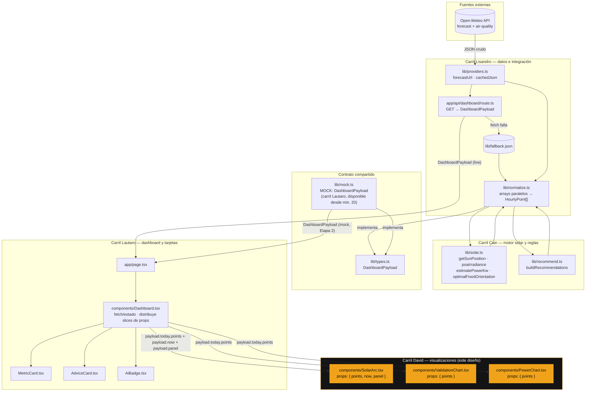
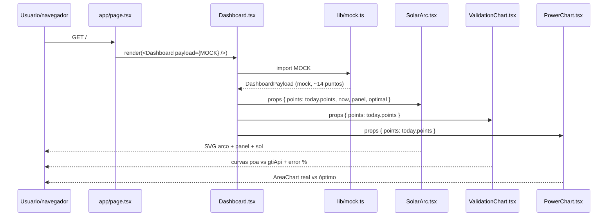
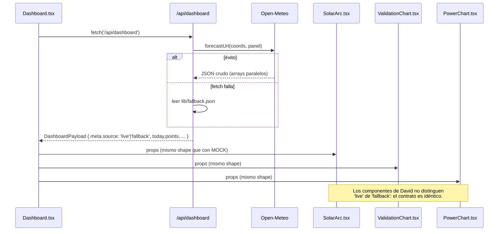

# Design Document: solar-visualizations

## Overview

Este documento describe el diseño de los tres componentes de visualización del carril de David dentro del dashboard de **SolariA**: `SolarArc.tsx` (gemelo digital del arco solar), `ValidationChart.tsx` (superposición del motor propio contra Open-Meteo) y `PowerChart.tsx` (área de pérdida entre potencia real y óptima).

Los tres son componentes de presentación puros (`'use client'` cuando corresponda para Recharts): no hacen `fetch`, no conocen la API ni el normalizador, y reciben únicamente los sub-tipos de `DashboardPayload` que necesitan como props desde `components/Dashboard.tsx` (carril de Lautaro). Esta frontera de tipos —no de archivo compartido— es la que permite que ambos carriles avancen en paralelo desde el minuto 20, apenas existe `lib/mock.ts`.

El diseño respeta las tres reglas no negociables del proyecto (§1 del Plan): azimut siempre en convención brújula (0=N, 90=E, 180=S, 270=O) dentro de `components/`, el sol no se dibuja si `elevation <= 0`, y ningún valor `NaN`/`Infinity` llega a pantalla. También sigue la dirección visual "Starlink" del Plan (fondo oscuro, acento único, mobile-first), llevada por el carril de David a una variante más estricta tipo **telemetría de lanzamiento SpaceX**: negro puro, líneas ultra delgadas, tipografía monoespaciada. Ver "Dirección visual (carril David)" más abajo.

### Dirección visual (carril David) — telemetría SpaceX

Estos tres componentes son los únicos con gráficos/SVG del proyecto, así que llevan su propia variante visual dentro de la paleta general del equipo:

| Elemento | Decisión |
|---|---|
| Fondo | Negro puro `#000000` (no `#0A0A0B`) para el lienzo de cada componente — mismo criterio que el HUD de un webcast de lanzamiento |
| Tipografía | **Roboto Mono** para todo texto dentro de los tres componentes: números grandes, ejes, leyendas, error medio. Pesos 400/500. `tabular-nums` en cualquier número que cambie |
| Líneas | Hairlines de `0.5px`–`1px` en trazos SVG (`stroke-width`), grillas y ejes de Recharts. Nada de trazos gruesos ni sombras |
| Acento | Ámbar `#F0A31A` reservado **solo** para el sol y la serie `poa`/`powerKw` (el dato "propio"); todo lo demás (trayectoria, ejes, grilla, panel) en blanco/gris a baja opacidad (`rgba(255,255,255,0.15–0.4)`) |
| Serie secundaria | `gtiApi`/`powerOptimalKw` en blanco puro o gris claro, trazo punteado fino — refuerza que es la referencia externa, no el dato propio |
| Densidad | Sin bordes redondeados decorativos, sin gradientes, sin sombras. Esquinas rectas o `2px` máximo |
| Números grandes | Error medio de `ValidationChart` y cualquier lectura numérica en Roboto Mono, `32–48px`, `tabular-nums`, como un contador de telemetría |
| Movimiento | Transiciones de 150–200ms como máximo, lineales, sin bounce — igual que un HUD, no una app consumer |

**Nota de integración:** `app/globals.css` es archivo exclusivo de Lautaro. Roboto Mono se importa localmente en los tres componentes de David (o se pide en voz alta agregar la fuente al layout raíz si el equipo decide unificarla) — no se edita `globals.css` desde este carril sin avisar (regla §5 del Plan).

## Architecture

_(Arquitectura general — contexto del sistema)_

El diagrama siguiente ubica los tres componentes de David dentro del flujo completo de datos del dashboard, desde la API hasta la pantalla. Los nodos resaltados en ámbar son su carril exclusivo.



**Puntos clave del diagrama:**
- Durante la Etapa 2 (paralelo), David consume `lib/mock.ts` directamente vía `Dashboard.tsx`; en la Etapa 3, Lisandro cambia el origen a `ROUTE` sin que los tres componentes de visualización se enteren, porque ambos implementan el mismo `DashboardPayload`.
- Ningún componente de David ve el JSON crudo de Open-Meteo ni las convenciones de azimut de SunCalc/Open-Meteo: todo llega ya normalizado a convención brújula dentro de `HourlyPoint`.
- `Dashboard.tsx` es el único punto que decide qué slice del payload le pasa a cada componente; esto mantiene la frontera de tipos entre carriles.

## Diagramas de secuencia

### Renderizado con mock (Etapa 2, en paralelo)



### Renderizado con datos en vivo (post Etapa 3)



## Components and Interfaces

### Componente 1: `SolarArc.tsx` — gemelo digital (must-have)

**Propósito:** dibujar en SVG la trayectoria del sol del día, el recorrido ya cumplido, la posición actual del sol y el panel (con su `tilt` y `azimuth`), en convención brújula.

**Props:**

```pascal
INTERFACE SolarArcProps
  points: HourlyPoint[]      // today.points — para la trayectoria completa
  now: HourlyPoint           // posición actual del sol
  panel: PanelConfig         // azimuth, tilt del panel instalado
END INTERFACE
```

**Responsabilidades:**
- Mapear cada `HourlyPoint.sun.elevation` a coordenadas SVG dentro de `viewBox="0 0 400 220"`, horizonte en `y=200`.
- Dibujar la trayectoria completa punteada y superponer en línea sólida el tramo ya recorrido (`ts <= now.ts`).
- Dibujar el sol como círculo ámbar en la posición de `now`, **solo si `now.sun.elevation > 0`**.
- Dibujar el panel como rectángulo rotado según `panel.tilt`, con una rosa de los vientos chica indicando `panel.azimuth` (convención brújula: 0=N arriba, 90=E derecha, 180=S abajo, 270=O izquierda).
- No renderizar nada que produzca `NaN`/`Infinity` en un atributo SVG (`d`, `cx`, `cy`, `transform`).

### Componente 2: `ValidationChart.tsx` — pico del pitch (must-have)

**Propósito:** superponer la irradiancia en el plano del panel calculada por el motor propio (`poa`) contra la reportada por Open-Meteo (`gtiApi`), y mostrar el error medio porcentual como número grande.

**Props:**

```pascal
INTERFACE ValidationChartProps
  points: HourlyPoint[]      // today.points
END INTERFACE
```

**Responsabilidades:**
- Graficar dos series (`poa` propio vs `gtiApi` de Open-Meteo) en el mismo eje temporal.
- Filtrar puntos con `gtiApi === null` o `gtiApi <= 20` antes de calcular el error (evita división por valores chicos que hacen explotar el error relativo).
- Calcular y mostrar el error medio porcentual como número grande (es la respuesta a "¿de dónde sale ese número?").
- Si no quedan puntos válidos tras el filtro, mostrar `0%` (nunca `NaN`).

### Componente 3: `PowerChart.tsx` — objetivo elástico

**Propósito:** mostrar visualmente la pérdida diaria como el área entre la curva de potencia real (`powerKw`) y la curva de potencia con la mejor orientación fija (`powerOptimalKw`), usando Recharts `AreaChart`. Requiere `'use client'`.

**Props:**

```pascal
INTERFACE PowerChartProps
  points: HourlyPoint[]      // today.points
END INTERFACE
```

**Responsabilidades:**
- Renderizar dos áreas superpuestas (`powerKw`, `powerOptimalKw`) en Recharts `AreaChart`, mismo eje temporal que `ValidationChart`.
- El área entre ambas curvas comunica visualmente la pérdida; no requiere cálculo propio adicional (los valores ya vienen resueltos en `HourlyPoint`).
- Si el tiempo no alcanza, este componente puede quedar comentado en `Dashboard.tsx` sin romper el resto (es el objetivo elástico, §3 del Plan).

## Data Models

Los tres componentes consumen exclusivamente subconjuntos de tipos ya definidos en `lib/types.ts` (contrato de todo el equipo, §4.1 del Plan). David **no define tipos nuevos**; solo consume:

```pascal
STRUCTURE SunPosition
  ts: Number            // epoch ms, UTC
  elevation: Number      // grados; negativo o cero = no se dibuja el sol
  azimuth: CompassAzimuth // 0=N, 90=E, 180=S, 270=O — SIEMPRE esta convención en components/
END STRUCTURE

STRUCTURE HourlyPoint
  ts: Number
  sun: SunPosition
  poa: Number             // irradiancia propia en el plano del panel (W/m²)
  gtiApi: Number | Null    // el mismo cálculo según Open-Meteo
  powerKw: Number
  powerOptimalKw: Number
  // (resto de campos de HourlyPoint no usados por David)
END STRUCTURE

STRUCTURE PanelConfig
  azimuth: CompassAzimuth  // orientación instalada
  tilt: Number             // 0 = horizontal, 90 = vertical
END STRUCTURE
```

**Reglas de validación (aplicadas dentro de los componentes, no en los tipos):**
- `elevation <= 0` ⟹ el sol no se dibuja en `SolarArc`.
- `gtiApi === null || gtiApi <= 20` ⟹ el punto se excluye del cálculo de error en `ValidationChart`.
- Cualquier división por un denominador que pueda ser `0` debe tener guard previo (ver Correctness Properties).
- Ningún valor calculado dentro de los tres componentes se asigna directamente a un atributo SVG o a una prop de Recharts sin pasar por `Number.isFinite`.

## Funciones clave con especificación formal (Low-Level Design)

### `elevationToY(elevation, horizonY, maxElevation)`

```pascal
FUNCTION elevationToY(elevation: Number, horizonY: Number, maxElevation: Number): Number
```

**Precondiciones:**
- `horizonY` y `maxElevation` son constantes fijas del componente (`horizonY = 200`, `maxElevation = 90`).
- `elevation` es un número finito (puede ser negativo).

**Postcondiciones:**
- Retorna `horizonY - (elevation / maxElevation) * 180`, siempre un número finito.
- Si `elevation <= 0`, el valor resultante no se usa para dibujar el sol (se filtra antes de llamar a esta función), pero la función sigue siendo total: no lanza excepción ni retorna `NaN`.

**Invariantes de bucle:** N/A (función pura sin bucle).

### `buildArcPath(points)`

```pascal
FUNCTION buildArcPath(points: HourlyPoint[]): String
```

**Precondiciones:**
- `points` es un arreglo (posiblemente vacío) de `HourlyPoint` ordenado por `ts` ascendente.

**Postcondiciones:**
- Retorna una cadena `d` válida para `<path>` de SVG.
- Si `points` está vacío, retorna cadena vacía `""` (no `NaN` embebido en el path).
- Cada segmento del path usa únicamente coordenadas `x`, `y` finitas; cualquier punto con `elevation` o `azimuth` no finito se omite del path.

**Invariantes de bucle:**
- En cada iteración sobre `points`, el acumulador de la cadena `d` contiene únicamente comandos SVG válidos generados a partir de coordenadas ya validadas como finitas.

### `splitTraveled(points, nowTs)`

```pascal
FUNCTION splitTraveled(points: HourlyPoint[], nowTs: Number): { traveled: HourlyPoint[], remaining: HourlyPoint[] }
```

**Precondiciones:**
- `points` ordenado por `ts` ascendente.
- `nowTs` es un epoch en ms.

**Postcondiciones:**
- `traveled` contiene todos los puntos con `ts <= nowTs`, `remaining` el resto.
- `traveled.length + remaining.length === points.length`.
- El orden relativo de `points` se preserva en ambos subconjuntos.

**Invariantes de bucle:**
- Durante el recorrido, todo punto ya visitado con `ts <= nowTs` fue agregado a `traveled` y ningún punto con `ts > nowTs` fue agregado a `traveled`.

### `computeMeanErrorPct(points)`

```pascal
FUNCTION computeMeanErrorPct(points: HourlyPoint[]): Number
```

**Precondiciones:**
- `points` es un arreglo (posiblemente vacío) de `HourlyPoint`.

**Postcondiciones:**
- Sea `valid = points.filter(p => p.gtiApi !== null AND p.gtiApi > 20)`.
- Si `valid.length === 0`, retorna `0`.
- En caso contrario, retorna `(Σ |p.poa − p.gtiApi| / p.gtiApi) / valid.length × 100`, un número finito y no negativo.
- Nunca retorna `NaN` ni `Infinity`.

**Invariantes de bucle:**
- El acumulador de suma de errores solo incorpora términos de puntos con `gtiApi > 20`, garantizando que el denominador de cada término nunca es cero ni cercano a cero.

### `toChartSeries(points)` (compartida por `ValidationChart` y `PowerChart`)

```pascal
FUNCTION toChartSeries(points: HourlyPoint[]): ChartPoint[]
```

**Precondiciones:**
- `points` es un arreglo de `HourlyPoint`.

**Postcondiciones:**
- Retorna un arreglo del mismo largo, donde cada `ChartPoint` tiene solo los campos numéricos finitos necesarios para el gráfico (`ts`, `poa`, `gtiApi | null`, `powerKw`, `powerOptimalKw`).
- Cualquier campo numérico no finito en el `HourlyPoint` de origen se reemplaza por `0` (o `null` en el caso de `gtiApi`, para que Recharts no interpole sobre el eje) antes de llegar a Recharts.

**Invariantes de bucle:**
- Todo elemento ya transformado del arreglo de salida cumple `Number.isFinite` en sus campos numéricos no-nulos.

## Algoritmo paso a paso: `SolarArc.tsx`

```pascal
ALGORITHM renderSolarArc(points, now, panel)
INPUT: points: HourlyPoint[], now: HourlyPoint, panel: PanelConfig
OUTPUT: SVG (<svg viewBox="0 0 400 220">)

BEGIN
  ASSERT points ordenado por ts ascendente

  // 1 · Trayectoria completa (punteada)
  fullPath ← buildArcPath(points)

  // 2 · Recorrido cumplido (sólida)
  { traveled, remaining } ← splitTraveled(points, now.ts)
  traveledPath ← buildArcPath(traveled)

  // 3 · Sol actual — SOLO si está sobre el horizonte
  IF now.sun.elevation > 0 THEN
    sunX ← elevationToX(now.sun, points)   // interpolación lineal amanecer→atardecer
    sunY ← elevationToY(now.sun.elevation, 200, 90)
    ASSERT Number.isFinite(sunX) AND Number.isFinite(sunY)
    dibujar círculo ámbar en (sunX, sunY)
  END IF
  // si elevation <= 0: no se dibuja ningún círculo de sol (regla no negociable)

  // 4 · Panel — rectángulo rotado por tilt + rosa de vientos por azimuth
  ASSERT panel.azimuth ∈ [0, 360) en convención brújula
  panelTransform ← `rotate(${panel.tilt})`
  dibujar rect con panelTransform
  dibujar marcador de rosa de vientos apuntando a panel.azimuth

  RETURN <svg>{fullPath, traveledPath, sol?, panel}</svg>
END
```

**Precondiciones:** `points` no vacío para que la trayectoria tenga sentido visual (con arreglo vacío, el componente retorna un SVG solo con horizonte y panel, sin excepción).
**Postcondiciones:** el SVG resultante no contiene ningún atributo con `NaN`/`Infinity`; el sol aparece si y solo si `now.sun.elevation > 0`.
**Invariantes de bucle:** ver `buildArcPath` y `splitTraveled` arriba.

## Algoritmo paso a paso: `ValidationChart.tsx`

```pascal
ALGORITHM renderValidationChart(points)
INPUT: points: HourlyPoint[]
OUTPUT: gráfico con dos series + número de error medio

BEGIN
  series ← toChartSeries(points)
  errorPct ← computeMeanErrorPct(points)

  ASSERT Number.isFinite(errorPct) AND errorPct >= 0

  RETURN {
    LineChart(series, dataKeys: ['poa', 'gtiApi']),
    BigNumber(errorPct.toFixed(1) + '%')
  }
END
```

**Precondiciones:** `points` puede estar vacío (caso de carga inicial); en ese caso `series = []` y `errorPct = 0`.
**Postcondiciones:** el número de error mostrado siempre es finito y ≥ 0.

## Algoritmo paso a paso: `PowerChart.tsx`

```pascal
ALGORITHM renderPowerChart(points)
INPUT: points: HourlyPoint[]
OUTPUT: AreaChart con powerKw vs powerOptimalKw

BEGIN
  series ← toChartSeries(points)
  RETURN AreaChart(series, areas: ['powerKw', 'powerOptimalKw'])
END
```

**Precondiciones:** `points` puede estar vacío; Recharts debe recibir `[]` en ese caso, no `undefined`.
**Postcondiciones:** ambas áreas se dibujan con datos finitos; la diferencia visual entre áreas nunca involucra `NaN`.

## Ejemplo de uso

```tsx
// components/Dashboard.tsx (carril Lautaro) — cómo se invocan los 3 componentes
import SolarArc from './SolarArc'
import ValidationChart from './ValidationChart'
import PowerChart from './PowerChart'

export default function Dashboard({ payload }: { payload: DashboardPayload }) {
  const { today, now, panel } = payload

  return (
    <div className="grid grid-cols-1 md:grid-cols-2 gap-4">
      {/* ... MetricCard, AdviceCard, AiBadge ... */}

      <SolarArc points={today.points} now={now} panel={panel} />

      <ValidationChart points={today.points} />

      {/* Elástico: puede quedar comentado si el reloj aprieta */}
      <PowerChart points={today.points} />
    </div>
  )
}
```

```tsx
// Ejemplo mínimo con datos de noche (elevation <= 0): el sol no se dibuja
const nightPoint: HourlyPoint = {
  ...basePoint,
  sun: { ts: Date.now(), elevation: -5, azimuth: 0 },
}
// <SolarArc points={[nightPoint]} now={nightPoint} panel={panel} />
// → el <svg> se renderiza con horizonte y panel, sin círculo de sol.
```

## Correctness Properties

Estas propiedades deben cumplirse para cualquier `HourlyPoint[]` válido (incluyendo `MOCK` y datos en vivo/fallback):

### Property 1: No-NaN / No-Infinity en pantalla

Para todo `points: HourlyPoint[]` y todo atributo SVG o valor de serie Recharts derivado de él, `Number.isFinite(valor) === true`. Ningún componente propaga `NaN` o `Infinity` a un atributo renderizado.

**Validates: Requirements 1.6, 2.5, 3.3, 5.2**

### Property 2: Sol invisible de noche

Para todo `now: HourlyPoint`, si `now.sun.elevation <= 0` entonces `SolarArc` no renderiza el elemento `<circle>` del sol. Recíprocamente, si `now.sun.elevation > 0` (y es finito), el sol se renderiza en una posición finita.

**Validates: Requirements 1.3, 1.4, 5.3**

### Property 3: Convención de azimut estable

Para todo `panel.azimuth` recibido como prop (ya en convención brújula, 0=N/90=E/180=S/270=O), el marcador visual de orientación en `SolarArc` apunta consistentemente a esa misma convención — nunca se aplica una conversión adicional dentro de `components/`.

**Validates: Requirements 1.5, 1.8, 5.1**

### Property 4: Error medio acotado y determinista

Para todo `points: HourlyPoint[]`, `computeMeanErrorPct(points)` retorna un valor en `[0, +∞)` finito, y retorna exactamente `0` cuando no hay puntos con `gtiApi > 20`.

**Validates: Requirements 2.2, 2.3, 2.4, 2.5**

### Property 5: Preservación de longitud en partición temporal

Para todo `points` y `nowTs`, `splitTraveled(points, nowTs).traveled.length + splitTraveled(points, nowTs).remaining.length === points.length`.

**Validates: Requirements 1.1, 1.2**

### Property 6: Idempotencia visual ante `mock` vs `live`/`fallback`

Dado el mismo shape de `HourlyPoint[]` (mismos campos, mismos tipos), los tres componentes producen el mismo tipo de salida visual sin importar si `meta.source` es `'live'`, `'fallback'` o si los datos vienen de `lib/mock.ts` — los componentes no leen `meta.source`.

**Validates: Requirements 4.3, 4.4**

### Property 7: Degradación segura con arreglo vacío

Para `points = []`, los tres componentes renderizan sin lanzar excepciones (horizonte/panel solos en `SolarArc`, gráficos vacíos en `ValidationChart`/`PowerChart`, error medio `0`).

**Validates: Requirements 1.7, 2.6, 3.4, 5.4**

## Error Handling

### Escenario 1: `points` vacío o `undefined` en tránsito

**Condición:** `Dashboard.tsx` renderiza antes de que el payload esté listo (estado de carga) o pasa un arreglo vacío.
**Respuesta:** cada componente trata `points` como `HourlyPoint[] = []` por defecto (prop con default o guard interno) y renderiza su estado vacío (SVG con solo horizonte/panel, gráficos sin series).
**Recuperación:** en cuanto `Dashboard.tsx` recibe el payload real, los componentes se re-renderizan con `points` completo sin necesidad de remount.

### Escenario 2: `gtiApi` nulo o irrelevante (cerca de cero)

**Condición:** de noche o al amanecer/atardecer, `gtiApi` puede ser `null` o un valor muy chico que hace explotar el error relativo.
**Respuesta:** `computeMeanErrorPct` filtra esos puntos (`gtiApi === null || gtiApi <= 20`) antes de calcular el promedio.
**Recuperación:** si todos los puntos quedan filtrados, se muestra `0%` en lugar de `NaN`.

### Escenario 3: valores no finitos en el payload (bug upstream)

**Condición:** por un bug en `lib/normalize.ts` o `lib/solar.ts`, algún `HourlyPoint` llega con `NaN`/`Infinity` en `poa`, `powerKw` u otro campo numérico.
**Respuesta:** `toChartSeries` sanea cada campo con `Number.isFinite` antes de pasarlo a Recharts/SVG, sustituyendo por `0` (o `null` en series que no deben interpolar).
**Recuperación:** el componente sigue renderizando el resto de la serie sin caerse; el punto saneado simplemente no aporta información errónea a la curva.

### Escenario 4: `elevation` exactamente en el borde (`elevation === 0`)

**Condición:** el sol está justo en el horizonte.
**Respuesta:** se aplica la regla estricta `elevation <= 0` ⟹ no se dibuja el sol (evita ambigüedad de "amanecer/atardecer exacto" mostrando un sol pegado al horizonte que además puede tener coordenadas degeneradas).
**Recuperación:** no aplica; es un comportamiento definido, no un error.

## Testing Strategy

### Unit testing

- `buildArcPath`, `elevationToY`, `splitTraveled`, `computeMeanErrorPct`, `toChartSeries` son funciones puras y se testean en aislamiento con Vitest/Jest, sin necesidad de renderizar React.
- Casos clave: arreglo vacío, un solo punto, puntos con `elevation` negativa mezclados con positiva, `gtiApi` nulo en algunos puntos, `nowTs` antes del primer punto y después del último.

### Property-based testing

**Librería sugerida:** `fast-check` (integra bien con TypeScript/Vitest, ya en el ecosistema del stack).

Propiedades a codificar directamente desde la sección *Correctness Properties*:
- Para cualquier `HourlyPoint[]` generado con `fast-check` (incluyendo campos `NaN`/`Infinity`/`null` inyectados a propósito), `toChartSeries` nunca retorna un campo numérico no finito.
- Para cualquier `elevation` generado (incluyendo negativos, cero, `NaN`), `SolarArc` no intenta dibujar el sol salvo que `elevation > 0` y sea finito.
- Para cualquier `points` y `nowTs` generados, `splitTraveled` preserva la longitud total.
- Para cualquier `points` generado, `computeMeanErrorPct` retorna un valor finito ≥ 0.

### Integration/visual testing

- Renderizar los tres componentes con `lib/mock.ts` (React Testing Library) y verificar ausencia de warnings en consola — es el criterio de "listo" definido en el Plan (§3 · David).
- Prueba manual con un punto de `MOCK` forzado a `elevation <= 0` para confirmar que el sol no aparece.
- Prueba manual alternando `meta.source: 'live' | 'fallback'` (una vez integrado con Lisandro) para confirmar que el shape de `HourlyPoint` es indistinguible desde los componentes de David.

## Performance Considerations

- Los tres componentes reciben como máximo `~14-72` puntos horarios (uno o pocos días de pronóstico): no se requiere virtualización ni memoización agresiva.
- `React.useMemo` es suficiente para evitar recomputar `buildArcPath`/`toChartSeries` en cada render si `points` no cambió de referencia.
- Recharts (`ValidationChart`, `PowerChart`) requiere `'use client'`; `SolarArc` puede ser Server Component si no necesita interactividad, reduciendo el JS enviado al cliente.

## Security Considerations

- No hay superficie de seguridad propia: los componentes no hacen `fetch`, no manejan credenciales ni input de usuario libre (solo props tipadas provenientes de `DashboardPayload`).
- Ningún dato mostrado es PII; son coordenadas fijas de Corrientes y series numéricas de irradiancia/potencia.

## Dependencies

- **React 19 / Next.js 15 (App Router)** — ya provisto por el proyecto.
- **Recharts** — usado en `ValidationChart.tsx` y `PowerChart.tsx` (instalado por Lisandro en Etapa 0).
- **SVG nativo** — usado en `SolarArc.tsx`, sin librería adicional.
- **`lib/types.ts`** — contrato de tipos compartido (`DashboardPayload`, `HourlyPoint`, `SunPosition`, `PanelConfig`).
- **`lib/mock.ts`** — fuente de datos durante la Etapa 2 (carril Lautaro).
- **fast-check** (sugerido, a agregar como devDependency si se decide escribir property tests) — no está en la lista de instalación de la Etapa 0; si se usa, avisar en voz alta antes de tocar `package-lock.json` (regla §5 del Plan).
