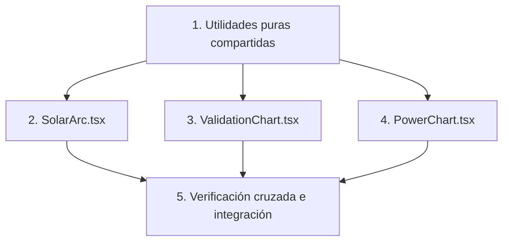

# Implementation Plan: solar-visualizations

## Overview

Plan de implementación para los tres componentes de visualización del carril de David (`SolarArc.tsx`, `ValidationChart.tsx`, `PowerChart.tsx`), en el orden de prioridad definido en el Plan del equipo: `SolarArc` (must-have) → `ValidationChart` (pico del pitch, must-have) → `PowerChart` (objetivo elástico, puede quedar comentado si el tiempo aprieta). Cada tarea de implementación referencia los criterios de aceptación de `requirements.md` que satisface, y las tareas de property-based testing referencian las Correctness Properties de `design.md`.

## Task Dependency Graph



`ValidationChart` y `PowerChart` reutilizan `toChartSeries` de la tarea 1, pero son independientes entre sí y pueden implementarse en paralelo o en cualquier orden después de `SolarArc`. Si el tiempo se agota, la tarea 4 (`PowerChart`) es la que se puede omitir sin bloquear la tarea 5.

```json
{
  "waves": [
    { "wave": 1, "tasks": ["1"] },
    { "wave": 2, "tasks": ["2", "3", "4"] },
    { "wave": 3, "tasks": ["5"] }
  ]
}
```

## Tasks

- [x] 1. Configurar utilidades puras compartidas
  - Crear archivo interno de helpers (o funciones locales dentro de cada componente) para `elevationToY`, `buildArcPath`, `splitTraveled`, `computeMeanErrorPct`, `toChartSeries`, según se especifica en design.md
  - Asegurar que ninguna de estas funciones importe `fetch`, `lib/providers.ts`, `lib/normalize.ts` ni variables de entorno
  - _Requirements: 4.1, 4.2_

- [ ] 2. Implementar `SolarArc.tsx` (must-have)
  - [x] 2.1 Implementar `elevationToY` y mapeo de coordenadas dentro de `viewBox="0 0 400 220"` con horizonte en `y=200`
    - _Requirements: 1.1_
  - [x] 2.2 Implementar `buildArcPath` y `splitTraveled` para trayectoria completa (punteada) y tramo recorrido (sólido)
    - _Requirements: 1.1, 1.2_
  - [x] 2.3 Escribir property test: preservación de longitud en `splitTraveled` para cualquier `points` y `nowTs` generados
    - _Requirements: 1.1, 1.2_
    - Property: para todo `points` y `nowTs`, `traveled.length + remaining.length === points.length`
  - [x] 2.4 Implementar renderizado condicional del sol (círculo ámbar) solo si `now.sun.elevation > 0` y es finito
    - _Requirements: 1.3, 1.4, 5.3_
  - [x] 2.5 Escribir property test: el sol nunca se dibuja si `elevation <= 0`, para cualquier valor de `elevation` generado (incluyendo negativos, cero, `NaN`)
    - _Requirements: 1.3, 1.4, 5.3_
    - Property: `elevation <= 0 ⟺` no se renderiza el elemento del sol
  - [ ] 2.6 Implementar el panel como rectángulo rotado por `tilt` con rosa de los vientos indicando `azimuth` en convención brújula
    - _Requirements: 1.5, 1.8, 5.1_
  - [ ] 2.7 Escribir property test: ningún atributo SVG (`d`, `cx`, `cy`, `transform`) resulta en `NaN`/`Infinity` para cualquier `points`, `now`, `panel` generados (incluyendo valores no finitos inyectados)
    - _Requirements: 1.6, 5.2_
    - Property: para toda entrada, todo atributo SVG derivado es `Number.isFinite`
  - [ ] 2.8 Manejar caso de `points` vacío sin lanzar excepciones (solo horizonte y panel)
    - _Requirements: 1.7, 5.4_
  - [ ] 2.9 Renderizar `SolarArc` con `lib/mock.ts` y confirmar visualmente cero warnings en consola
    - _Requirements: 1.1, 1.2, 1.3, 1.4, 1.5, 1.6, 1.7, 1.8_

- [ ] 3. Implementar `ValidationChart.tsx` (pico del pitch, must-have)
  - [ ] 3.1 Implementar `toChartSeries` para transformar `HourlyPoint[]` en series `poa`/`gtiApi` listas para graficar
    - _Requirements: 2.1, 4.1_
  - [ ] 3.2 Implementar filtro de puntos con `gtiApi === null || gtiApi <= 20` antes de calcular el error
    - _Requirements: 2.2_
  - [ ] 3.3 Implementar `computeMeanErrorPct` con guard de arreglo vacío/filtrado (retorna `0`)
    - _Requirements: 2.3, 2.4, 2.5_
  - [ ] 3.4 Escribir property test: `computeMeanErrorPct` siempre retorna un valor finito en `[0, +∞)`, y `0` cuando no hay puntos con `gtiApi > 20`, para cualquier `points` generado (incluyendo `gtiApi` nulo, negativo, cero, y `poa`/`gtiApi` no finitos)
    - _Requirements: 2.2, 2.3, 2.4, 2.5_
    - Property: para todo `points`, `computeMeanErrorPct(points) ∈ [0, +∞)` finito
  - [ ] 3.5 Renderizar las dos series superpuestas (`poa` vs `gtiApi`) y el número grande de error medio
    - _Requirements: 2.1, 2.3_
  - [ ] 3.6 Manejar caso de `points` vacío sin lanzar excepciones (gráfico vacío, error `0%`)
    - _Requirements: 2.6_
  - [ ] 3.7 Renderizar `ValidationChart` con `lib/mock.ts` y confirmar visualmente cero warnings en consola
    - _Requirements: 2.1, 2.2, 2.3, 2.4, 2.5, 2.6_

- [ ] 4. Implementar `PowerChart.tsx` (objetivo elástico)
  - [ ] 4.1 Configurar componente con directiva `'use client'` y `AreaChart` de Recharts
    - _Requirements: 3.1, 3.2_
  - [ ] 4.2 Reutilizar `toChartSeries` para pasar `powerKw`/`powerOptimalKw` saneados a Recharts
    - _Requirements: 3.1, 3.3_
  - [ ] 4.3 Escribir property test: ninguna serie pasada a Recharts contiene `NaN`/`Infinity`, para cualquier `points` generado (incluyendo valores no finitos inyectados en `powerKw`/`powerOptimalKw`)
    - _Requirements: 3.3_
    - Property: para todo `points`, toda serie resultante cumple `Number.isFinite` en sus campos numéricos
  - [ ] 4.4 Manejar caso de `points` vacío pasando `[]` a Recharts (nunca `undefined`) sin lanzar excepciones
    - _Requirements: 3.4_
  - [ ] 4.5 Renderizar `PowerChart` con `lib/mock.ts` y confirmar visualmente cero warnings en consola
    - _Requirements: 3.1, 3.2, 3.3, 3.4_

- [ ] 5. Verificación cruzada de convenciones e idempotencia (integración del carril)
  - [ ] 5.1 Escribir property test: dado el mismo shape de `HourlyPoint[]`, los tres componentes no leen ni dependen de `meta.source` (`'live'` vs `'fallback'` vs mock)
    - _Requirements: 4.3, 4.4_
    - Property: la salida visual no varía en función de `meta.source`
  - [ ] 5.2 Confirmar manualmente con la prueba de humo del Plan (§1): Corrientes, azimut ≈ 0° en el arco solar cuando corresponde norte franco, sin conversión adicional dentro de `components/`
    - _Requirements: 5.1_
  - [ ] 5.3 Integrar los tres componentes en un `Dashboard.tsx` de prueba local (o coordinar con el carril de Lautaro) verificando el flujo mock → props → render descrito en el diagrama de secuencia de design.md
    - _Requirements: 4.1, 4.2, 4.3, 4.4_

## Notes

- El carril de David depende de `lib/mock.ts` (carril de Lautaro, disponible desde el minuto 20) para poder empezar a trabajar; hasta entonces se puede avanzar con datos de prueba locales que respeten el shape de `HourlyPoint[]`.
- La tarea 4 (`PowerChart.tsx`) es el objetivo elástico del proyecto: si el reloj de la hackatón aprieta, se puede saltear sin afectar la tarea 5 salvo por el sub-paso que verifica los tres componentes juntos.
- Las property-based tests sugeridas usan `fast-check`; si se decide incorporarlo, avisar en voz alta antes de tocar `package-lock.json` (regla §5 del Plan del equipo).
- El criterio de "listo" para cada componente, según el Plan, es que renderice con `lib/mock.ts` sin un solo warning en consola.
