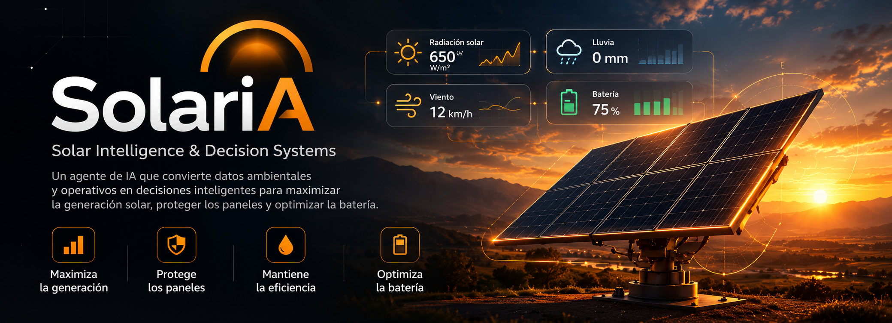

# SolariA: Autonomous Solar Mechatronics & Financial Prospecting

> **Pairing deterministic sub-115ms edge decisions (AWS Strands Decider 2B) with on-demand executive financial synthesis (Amazon Bedrock & Amazon Nova Lite).**  
> Grounded in Werner Vogels' **"The Frugal Architect"** design principles.

[](./solaria_strands_decider_bedrock.ipynb)
[](./articulo.md)
[](https://nextjs.org/)
[](https://www.typescriptlang.org/)
[](https://aws.amazon.com/bedrock/)
[](https://vitest.dev/)
[](#bilingual-experience)

---

## Executive Overview

**SolariA** transforms solar field prospecting and hardware operations from static telemetry dashboards into an autonomous cyber-physical intelligence platform.

### The Problem
- **Cosine Incidence Loss (up to 30% lost MWh):** Fixed-tilt solar panels only capture peak normal irradiance for a narrow window around solar noon. Throughout the morning and afternoon, angular misalignment dissipates energy potential.
- **Particulate Soiling (up to 15% generation loss):** Dust, agricultural pollen, and sand accumulate on panel glass. In utility-scale solar farms, mitigating this requires expensive manual washing crews with high freshwater consumption.

### The Frugal Architecture Solution
Deploying heavy, cloud-based 70B+ LLMs to control real-time robotic gearboxes is an ecological and economic paradox: **burning megawatts of cloud compute to optimize kilowatts of clean energy**. A motor cannot wait 2,000 milliseconds for a cloud language model when a 65 km/h wind gust hits.

SolariA implements a **two-tier intelligence hierarchy**:
1. **Tier 1 — Sub-115ms Edge Decisioning:** High-frequency telemetry evaluation and hardware tool dispatch are handled locally by **AWS Strands Decider 2B** (`#tool-selection`), guaranteeing physical safety and zero cloud token waste.
2. **Tier 2 — On-Demand Generative Synthesis:** Heavy generative capabilities are reserved exclusively for executive capital investment proposals and land yield summaries via **Amazon Bedrock (Amazon Nova Lite)**, invoked only when human decision-makers request a report.
3. **Resilient Local Autonomous Mode:** Zero external downtime dependencies. If Bedrock or the edge decider endpoint is unreachable, the system automatically falls back to an autonomous local valuation engine while explicitly identifying decision provenance.

---

## System Architecture

```text
               ┌────────────────────────────────────────────────────────┐
               │                PHYSICAL / VIRTUAL EDGE                 │
               │   • Real-Time Solar Azimuth & Elevation (Open-Meteo)   │
               │   • Anemometer (Wind Gusts) & Rain Gauges (Precip)     │
               │   • Pyranometer (DNI / GTI) & Battery State of Charge  │
               └───────────────────────────┬────────────────────────────┘
                                           │ Sub-115ms Telemetry
                                           ▼
               ┌────────────────────────────────────────────────────────┐
               │              AWS STRANDS DECIDER 2B                    │
               │               (#tool-selection Engine)                 │
               │                                                        │
               │   [1] follow_sun_optimal_tracking                      │
               │   [2] clean_panels_rainwash (Tilt 65°)                 │
               │   [3] emergency_storm_stow (Tilt 0°)                   │
               │   [4] battery_conservation_hold                        │
               └───────────────────────────┬────────────────────────────┘
                                           │ Selected Mechatronic State
                                           ▼
┌───────────────────────────────────────────────────────────────────────────────────┐
│                          SOLARIA INTERACTIVE PLATFORM                             │
│                                                                                   │
│  ┌───────────────────────────────┐     ┌───────────────────────────────────────┐  │
│  │   SOLAR DIGITAL TWIN (SVG)    │     │      GLOBAL HEATMAP PROSPECTING       │  │
│  │ • 24h Kinematic Solar Arc     │     │ • Multi-Corridor MapLibre GL Layer    │  │
│  │ • Bi-directional Tracker Tilt │     │ • Dynamic DNI & Land Surface (Ha)     │  │
│  │ • Real-Time Open-Meteo Curve  │     │ • Topology: Trackers / Bifacial / Agri│  │
│  └───────────────────────────────┘     └───────────────────┬───────────────────┘  │
│                                                            │                      │
│                                                            ▼                      │
│                                        ┌───────────────────────────────────────┐  │
│                                        │        AMAZON BEDROCK SYNTHESIS       │  │
│                                        │       (Model: Amazon Nova Lite)       │  │
│                                        │ • 2-Paragraph Investment Thesis       │  │
│                                        │ • CapEx, Gross Revenue & Simple ROI   │  │
│                                        │ • Resilient Autonomous Fallback       │  │
│                                        └───────────────────────────────────────┘  │
└───────────────────────────────────────────────────────────────────────────────────┘
```

---

## Key Pillars & Capabilities

### 1. Global Solar Corridor Heatmap & Prospecting
- **Interactive Multi-Region Map**: Powered by MapLibre GL with smooth tile caching across major global solar corridors:
  - *Global Overview*
  - *South America* (Atacama, Cuyo, Chaco)
  - *North America* (Mojave, Sonora, Texas Corridor)
  - *Europe & MENA* (Iberia, Sahara, Arabian Peninsula)
  - *Asia-Pacific* (Thar Desert, Western Australia)
- **Direct Normal Irradiance (DNI)**: Dynamic spatial lookup correlating latitude, longitude, and historical irradiance.
- **Topology & Capacity Modeling**: Instant financial valuation for Single-Axis Trackers, Fixed-Tilt Bifacial arrays, and Agrivoltaics Dual-Use deployments (CapEx, OpEx, Gross Annual Revenue, Simple Payback, and 10/20-Year Net Return).

### 2. Digital Twin & Live Solar Telemetry
- **Precision Solar Arc**: Real-time solar azimuth and solar altitude calculations based on user clock or simulation scrubbers.
- **Bi-Directional Kinematic Simulation**: Visual representation of solar tracker tilt and orientation matching the sun's trajectory.
- **Open-Meteo Integration**: Live hourly telemetry curves including Direct Normal Irradiance ($W/m^2$), ambient temperature, and wind speed.
- **Cinematic Visuals**: Ambient solar halo pulsation and SpaceX-inspired dark mode aesthetic.

### 3. Frugal AI Architecture & Decision Provenance
- **AWS Strands Decider 2B Pattern**: Evaluates live environmental sensor signals (e.g., wind gusts > 60 km/h, rain cleaning windows, tracking angles) and selects actuation tools deterministically in milliseconds:
  - `emergency_storm_stow` (Flat 0° during gale winds).
  - `clean_panels_rainwash` (Tilt 65° during rainfall to wash surface dust).
  - `follow_sun_optimal_tracking` (Continuous perpendicular sun tracking).
  - `battery_conservation_hold` (Motor park when battery SoC is low).
- **Amazon Bedrock Executive Synthesis**: Synthesizes a structured 2-paragraph investment thesis, financial highlights, and frugal architecture notes using `@aws-sdk/client-bedrock-runtime` and the Converse API with **Amazon Nova Lite** (`amazon.nova-lite-v1:0`).
- **Transparent Provenance**: The UI and API clearly label every output's origin (`strands-decider-2b` vs `heuristic-fallback` and `amazon-bedrock` vs `local-fallback` with fallback reasons such as `disabled`, `request_failed`, or `invalid_response`).

---

## Interactive Jupyter & SageMaker Notebook

For machine learning engineers, data scientists, and hackathon judges evaluating model inference:

👉 [`solaria_strands_decider_bedrock.ipynb`](./solaria_strands_decider_bedrock.ipynb)

- **Ready to run in:** Amazon SageMaker Studio, SageMaker AI Notebooks, JupyterLab, and Google Colab.
- **Covers:** Sensor telemetry simulation, dark-mode `matplotlib` solar arc plotting, Strands Decider `#tool-selection` implementation, and Amazon Bedrock Nova Lite Converse API execution with fallback verification.

---

## Architectural Benchmark: The Frugal Architect

| Operational Dimension | AWS Strands Decider 2B (Edge) | Cloud 70B+ LLM (Datacenter) |
| :--- | :--- | :--- |
| **Primary Role** | Real-time Mechatronics & Tool Selection | Strategic Capital Reporting |
| **Decision Latency** | **< 15 ms** (sub-115ms guaranteed) | 1,800 – 3,500 ms |
| **Token Burn** | **0 tokens** (Deterministic choice) | 400 – 1,200 tokens |
| **Energy Consumption** | **~0.00008 Wh** per decision | ~0.24 Wh per invocation |
| **Offline Survivability** | **100% Operational** | Network & Quota Dependent |

---

## Bilingual Experience

SolariA includes zero-dependency, type-safe internationalization:
- **English (US)**: Default international presentation for global clean energy investors.
- **Español (Rioplatense / LatAm)**: Tailored copy for regional operators and Latin American clean energy stakeholders.

Toggle language dynamically in the top navigation bar without page reload.

---

<details>
<summary><b>🛠️ Developer Appendix: Local Setup, Tests & Server-Side Configuration</b></summary>

### Prerequisites
- Node.js `^20.0.0 || ^22.0.0`
- npm `^10.0.0`

### Local Execution
```bash
# Clone & install
git clone https://github.com/DavidBritto/solaria.git
cd solaria
npm install

# Start development server
npm run dev
```
Open [http://localhost:3000](http://localhost:3000) in your browser.

### Verification & Testing Suite
All features, financial math, and fallback mechanisms are covered by automated tests:
```bash
# Run Vitest test suite (46 unit & integration tests)
npm test

# Verify TypeScript strict types
npx tsc --noEmit

# Production build test
npm run build
```

### Optional Server-Side Integrations (`.env.local`)
Create an untracked `.env.local` to enable live cloud endpoints:
```dotenv
# AWS Strands Decider 2B Endpoint (Self-Hosted Edge Service)
STRANDS_DECIDER_ENDPOINT=http://127.0.0.1:8000/v1/systemone
STRANDS_DECIDER_MODEL=replace-with-model-name-from-health

# Amazon Bedrock Synthesis
BEDROCK_ENABLED=true
AWS_REGION=us-east-1
BEDROCK_MODEL_ID=amazon.nova-lite-v1:0
```
When Bedrock is disabled or unreachable, the system automatically falls back to the autonomous local valuation engine.
</details>

---

## Compliance & Disclaimer

Financial projections, installed capacity figures, and land yield metrics are illustrative outputs from the deterministic valuation model and do not constitute certified project economics or financial advice. Decision provenance metadata must be reviewed prior to operational reliance. See [`REUSABLE_DECIDER_PATTERN.md`](./REUSABLE_DECIDER_PATTERN.md) for detailed tool-selection design and integration patterns.
